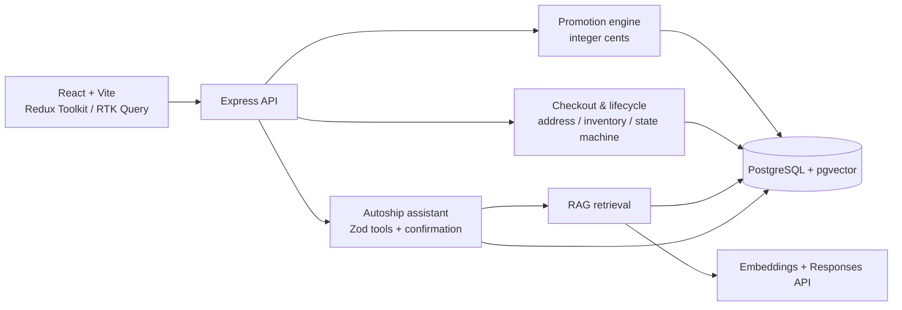

# Chewy Autoship Promo Desk

A demo-ready full-stack Autoship experience for Chewy: promotion eligibility, checkout/subscriptions, policy RAG, and a confirmation-first assistant.

## Architecture



## Three-screen flow

1. **Product** — choose Blue Buffalo flavor and bag size; the Autoship card recalculates the welcome offer and eligibility message.
2. **Checkout** — review an address-verification badge, selected item, welcome discount, and tax-before-total summary; place the first Autoship order.
3. **Manage Autoship** — view the next ship date, delay/skip/edit/address actions, stock notice, and confirmation-required cancellation.

The Product page also includes a policy search box and an Autoship Assistant panel.

## Run locally

```bash
npm install
cp .env.example .env
# Set OPENAI_API_KEY in .env for RAG ingestion and policy Q&A.
docker compose up -d
npm run ingest
npm run dev
```

`npm run dev` starts both Express and Vite together. Open `http://127.0.0.1:5173/overview`. Run automated checks with `npm test --workspace=server`, `npm run build`, and `npm run eval`.

## Features and technical difficulties

### Promotion engine

1. **Concurrent first-offer redemption:** [redeem.ts](server/src/promotion/redeem.ts) wraps the insert in a transaction and relies on database unique keys for `(customer_id, promotion_id)` and `idempotency_key`; a concurrent-request test verifies one success and one conflict.
2. **Accurate capped pricing:** [calculatePrice.ts](server/src/promotion/calculatePrice.ts) uses integer cents and basis points, floors fractional cents, caps the first order at 2000 cents, and chooses exactly one highest-priority promotion.

### Checkout and subscription lifecycle

1. **No overselling:** [postgresInventory.ts](server/src/lifecycle/postgresInventory.ts) uses `UPDATE ... WHERE available_quantity >= quantity` and makes a 10-minute reservation in the same transaction; expired reservations release stock.
2. **Safe lifecycle changes:** [service.ts](server/src/lifecycle/service.ts) explicitly permits only valid transitions and saves write results under idempotency keys, so retries replay instead of repeating changes.

### RAG pipeline

1. **Preserving exceptions:** [policyParser.ts](server/src/rag/policyParser.ts) splits only at level-two headings, so each rule and its exception remain in one chunk with file, section, and version metadata.
2. **Fresh index without waste:** [ingest.ts](server/src/rag/ingest.ts) SHA-256 hashes each policy, skips unchanged files, replaces chunks only for changed files, and deletes records for removed files.

### Agentic assistant

1. **Safe tool use:** [assistant.ts](server/src/agent/assistant.ts) validates tool inputs, fixes every run to the logged-in customer, and produces expiring pending tokens rather than executing skip/delay/cancel immediately.
2. **Grounding and auditability:** assistant results expose tool names and citations, while `agent_runs` / `agent_actions` provide the persistent audit schema; the loop is designed for a six-step maximum.

## Important demo boundary

The local assistant is deliberately deterministic so its safe flows are testable without an API key. Set `.env` and run ingestion to use the OpenAI/pgvector policy route; the production adapter is in `server/src/rag`.
